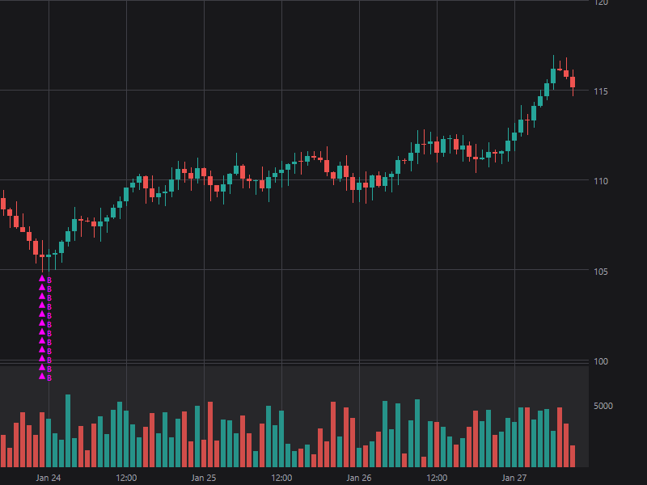

# KLineChart-go 全库复审（2026-10-21，当前工作区）

## 结论

当前库的原生绘制、共享视口、数据源边界和常规指标计算已有较好的实现与测试基础；回放和扩展接口还有会影响真实宿主的缺陷。**现阶段不能把“无前视回放”视为已满足的可靠契约。**

本轮确认 **10 项缺陷：2 项 P1、8 项 P2**。Standards 轴有 2 项 P2；Spec 轴有 8 项，其中 2 项 P1。另有 1 项关闭后恢复订阅的文档契约冲突，单独记录，不混入确定缺陷数量。没有提出推测性的并发问题，也没有把覆盖率不足直接算作功能缺陷。

范围是 `main` / HEAD `d966ad139d90ef3fa89c78edce980c5325204dbf` 加本轮开始时的工作区改动与未跟踪源码，**不是仅审查该提交或一个 PR diff**。开始时已存在另一份 `2026-10-21-full-review.md`；本报告独立保存，未改写它。72 个 Go 源码/模块文件的初始 SHA-256 已保存，复核时均未变化。

- [执行计划](../plans/2026-10-21-comprehensive-review-plan.md)
- [复现说明及一键脚本](evidence/2026-10-21-comprehensive/README.md)
- [确认缺陷的实际运行日志](evidence/2026-10-21-comprehensive/confirmed-probes.log)
- [源码快照清单](evidence/2026-10-21-comprehensive/source-manifest.json)

## Standards：规范、扩展与维护边界

### S1 · P2 · 第二个同类型副图指标被静默丢弃

位置：`kline/paint.go:129–133`；相关布局：`kline/chart.go:290–291`。

README 第 202 行承诺宿主副图使用额外 band。注册 `FASTMACD`，构造器返回 `NewMACD(3, 6, 2)`，与内置 `MACD` 同时启用，注册和计算都成功，但最终只有 **1 个绘制 layer**。布局把两个 `*MACD` 写到同一个 `panes.MACD`，绘图又仅保留第一个实例，导致用户启用的第二个指标没有图像。

建议按注册项/实例身份分配和绘制副图，为额外实例分配额外矩形。这里的 **Repeated Switches** 是有行为后果的维护性线索：两个具体类型分支分别管理布局与绘制，并非单纯风格问题。复现：`TestReviewSecondMACDActuallyPaints`。

### S2 · P2 · 内置指标名称可以被卸载并替换

位置：`kline/indicator.go:127–137`。

README 第 154 行说明 `Unregister` 删除宿主条目，并承诺内置名称保持保留。实际 `Unregister("MA")` 可删除内置 MA，随后 `Register(Spec{Name:"MA", Kind:PaneSub, New:...NewMACD...})` 成功。这个进程级变动会影响之后创建或同步注册表的所有 chart，包括默认指标。

建议让内置名称的保护独立于当前注册表内容，卸载仅作用于宿主条目，并与 overlay 注册表的保留规则一致。复现：`TestReviewBuiltinIndicatorsStayReserved`。

Standards 轴：**2 项 P2**；主要影响是扩展条目被接受后无法正确呈现，以及保留名称可污染进程级默认状态。未额外报告纯命名、文件长度等风格意见。

## Spec：实际行为与契约

### B1 · P1 · OnBar 更换回放后，旧回放仍写入新回放的图表

位置：`kline/replay.go:351–355`。

`advance` 只在进入循环前检查 `ready()`，`OnBar` 执行后不再检查回放是否仍拥有图表。公开注释禁止回调重入 Step/Seek/Tick，但未禁止 Close、StartReplay 或其他生命周期操作。

复现：旧回放执行 `Step(4)`，第一个 `OnBar` 中调用 `StartReplay` 创建替代回放。调用结束时，新回放 `Cursor()==0`，图表却有旧回放继续写入的 **3 根 bar**。这直接违反 AGENTS 的回放所有权和 README“panes only contain the revealed prefix”。简单的回调 `Close()` 也无法停止剩余揭晓；`Tick` 中回调 `Pause()` 后仍继续消费已算出的批次。

建议在每次回调返回后核对 closed、图表绑定的 replay 身份；Tick 逐步推进时还需尊重暂停。关闭、替换和换源应停止当前批次。复现：`TestReviewStartReplayDuringOnBarPreservesNewCursor`、`TestReviewCloseDuringOnBarStopsAdvance`、`TestReviewPauseDuringOnBarStopsTick`。

### B2 · P1 · 大周期的未完成桶提前显示未来交易标记

位置：`kline/marker.go:165`；相关重建：`kline/replay.go:476–480`。

回放只揭晓 08:00 和 09:00 两根 1h bar，预先保存 10:00 的交易标记。1h 下标记隐藏；切为 4h 后，标记按完整 `[08:00,12:00)` 桶映射到第 0 根，图表与 `Readout` 提前出现 `HIDDEN_TRADE`。回放游标仍为 2，10:00 bar 尚未揭晓。

这违反 README 第 28/142 行关于游标之后标记隐藏的明确约定。仅限制 candles 前缀不足以保证标记无前视。建议先根据基础周期的已揭晓区间判断标记是否可见，再将可见标记映射到聚合桶；Step、Seek、换周期和 SetMarkers 均需使用同一规则。复现：`TestReviewCoarseReplayHidesFutureMarkers`。

### B3 · P2 · 普通周期切换使用旧周期重算末根标记

位置：`kline/chart_load.go:175–177`。

`install` 先 `mount`，其中 `reindexMarks` 读取 `a.period`，之后才赋值新周期。末根 bar 的结束时间因此按旧周期计算。以 00:00 开盘的末根和 03:00 交易为例：1h→4h 后应显示却得到 `bar=-1`；4h→1h 后应隐藏却得到 `bar=0`，读数仍列出该交易。

建议把目标周期显式传入索引过程，或在已通过加载校验后、mount 前安装目标周期。这个问题与 B2 不同：它不依赖 replay，也不能仅修正 replay 截止时间解决。复现：`TestReviewPeriodSwitchReindexesLastBarWithNewPeriod` 的两个子用例。

### B4 · P2 · 跨休市缺口的时间刻度标到错误交易日

位置：`kline/paint.go:239–247`。

蜡烛按等宽 bar index 排列，时间刻度却将左右端点之间的自然时间直接线性映射到 X。数据为周五 1 月 5 日、周一 1 月 8 日及随后交易日，bar 宽 100、图宽 600 时，周一刻度落在 `x=225`，属于周二蜡烛；周一实际在 `[100,200]`。真实交易时段、周末或停牌缺口都会暴露此问题，常规等间隔 Generate fixture 看不出来。

建议以蜡烛索引生成刻度，或将时间刻度反查到实际 bar 的 X 坐标，使轴、蜡烛和十字线共用一个横轴映射。复现：`TestReviewSessionGapMisplacesTimeTick`。

### B5 · P2 · LinePlot 返回 nil 时不会进入承诺的 DrawMain 后备路径

位置：`kline/paint.go:92–94`。

`indicator.go:52–56` 明确允许实现 LinePlot 的主图指标返回 nil Series，改由 DrawMain 画填充/标记。实际只要类型实现 LinePlot，就无条件调用线条绘制并 continue。复现自定义指标的 `Series()==nil` 时 `DrawMain` 调用次数为 **0**，图形静默消失。

建议依据 Series 是否为 nil 选择路径，而非只依据接口断言。复现：`TestReviewNilLinePlotCallsDrawMain`。Overlay 不调用 DrawMain 是已写明的限制，不在此问题范围内。

### B6 · P2 · 叠放交易标记越界覆盖成交量副图

位置：`kline/marker.go:274–276`；调用方：`kline/chart.go:507`。

蜡烛和 overlays 有价格区裁剪，marker 的箭头和文字没有。在最低可见蜡烛处放 12 个 buy 标记，headless 原生绘制图像的成交量区域出现 **46 个标记专用颜色像素**。这会遮挡量柱，更多标记还会覆盖下方其他区域。

建议将 marker 的箭头、文字及价格 tick 统一放在价格矩形 clip 内；若需要展示超出高度的数量，可另定产品规则。复现：`TestReviewMarkersMustStayInsidePricePlot`。

### B7 · P2 · Overlay 无共同正收盘价时仍对主标的指数化

位置：`kline/compare.go:129–131`、`261–262`。

README 第 10 行约定找不到两者都为正的 close 时，退回 ALPHA 原始价格轴。实际 `IndexBase` 找不到时返回 0，后续只验证 primary，遗漏 compare。ALPHA 约 10 元、BETA 全零的复现中，`indexed=true`，轴范围为 `[96,104]`，而应为原价的 `[9.6,10.3]`。宿主因此得到与承诺不符的价格单位和成功标志。

建议在尺度、绘制和 header 共用完整的“参与比较的所有序列都可指数化”判断，明确区分没有共同基准与合法的索引 0。复现：`TestReviewCompareFallbackNeedsBothSeries`。

### B8 · P2 · 初始加载绕过 pending bars 的 512 根上限

位置：`kline/chart_load.go:132–134`。

新上限只通过 `hold()` 约束 live/AppendBar，`alignInit` 直接复制领先标的的后缀。正常请求窗口内，A 返回 600 根、B 仅有第一根，加载成功后 A 的 held 为 **599**，超过 512，`AlignError()==nil`。无需超大或乱序输入即可违反 README 第 243 行“one pane holds at most 512 pending bars”。若源返回更长窗口，初始路径仍无约束。

建议让初始化和重载共用 pending 截断与错误报告逻辑，并避免 install 清除新产生的丢弃报告。复现：`TestReviewInitHeldCap`。

Spec 轴：**8 项确认问题：2 P1、6 P2**；最严重的是两条无需并发即可触发的回放前视路径。

## D1 · 单独记录的文档契约冲突

`README.md:148` 说明 Close 后可通过后续 SetPeriod/SetSource 重载并恢复订阅，用于隐藏后再次显示；第 146 行同时明确同周期 SetPeriod 是 no-op。代码遵循后者：`Close(); SetPeriod(chart.Period())` 返回 nil，订阅数仍为 0，后续推送被忽略。已有 `TestCloseThenSetPeriodResubscribes` 换了一个不同周期，未覆盖此组合。

由于文档同时支持两种解释，不把它直接升级为确定实现缺陷。需要统一契约：若支持同周期恢复，应记录关闭/订阅状态；若保留 no-op，应明确恢复需用 SetSource 或不同周期。实际复现保存在 [reopen-contract.log](evidence/2026-10-21-comprehensive/reopen-contract.log)。

## 已完成的验证

环境：Windows amd64，Go 1.27.1。审查阶段使用 `CGO_ENABLED=0` 的源码副本；修复后另用临时 MinGW-w64 GCC 16.2.0 和 `CGO_ENABLED=1` 运行 Windows race suite。

| 检查 | 结果与边界 |
| --- | --- |
| `go build ./...` | 通过，含三个 example 包 |
| `go vet ./...` | 通过 |
| `go test ./... -count=1` | 五个包全部通过，含现有分配预算 |
| 覆盖率运行 | 201 个顶层 Test、10 个 Example、36 个子用例通过；不是 247 个独立顶层测试 |
| `kline` 覆盖率 | 88.1% statements；整个模块 83.6%；demo 80.7% |
| `go test ./kline -run Example -v` | 10 个公开 API 示例全部通过 |
| `go run ./examples/replay` | 实际 headless 运行成功，输出包含 replay 写入拒绝、聚合和关闭行为 |
| `gofmt -l .` | 源码快照无输出 |
| `go mod verify` | 所有模块校验通过；不等价于上游依赖安全审计 |
| `go test ./... -race -count=1` | 修复后已在 Windows amd64 通过；使用临时 MinGW-w64，未安装系统级编译器或修改系统环境 |
| 新的隔离复现 | 12 个顶层缺陷断言失败，对应 10 项根因；另有有限值指标一致性检查通过。失败日志是缺陷证据，不是原仓库测试回归 |
| 指标附加检查 | 250 根 bar、10 组 MA/BOLL/MACD/KDJ 参数，每次 Append 及反复 Revise 对比完整 Calc，通过（相对容差 1e-8） |
| 原生绘制验证 | 使用 MyGo `ui.NewTester` 及像素检查；未把它表述为真实桌面窗口交互验收 |
| CI / 跨平台 | workflow 已改为 Windows 主矩阵；本工作区未验证远端 CI 运行结果，也未实测 macOS/Linux GUI |

`examples/replay` 的覆盖率为 0% 是其测试不调用 main 的结果；本轮另运行该命令验证了 main。覆盖率数字只说明现有执行覆盖，B1/B2 等状态组合仍须针对性测试。

### 性能测量

8k bars，现有基准各运行三次，`-benchtime=200ms -benchmem`。使用同机 Windows 基线判断 bytes/op，不替换 `bench/baseline.txt`。

| 路径 | 三次时间范围 | 分配 | 现有上限 |
| --- | --- | --- | --- |
| CompareScales | 14.9–15.6 µs/op | 14,672 B/op | 49,152 B/op |
| Stack pan frame | 1.71–1.76 ms/op | 172,978–172,990 B/op，738 allocs | 221,184 B/op |
| Overlay pan frame | 1.64–1.77 ms/op | 83,991–83,998 B/op，336 allocs | 94,208 B/op |
| AppendBar | 0.296–0.327 µs/op | 848–961 B/op，1 alloc | 8,192 B/op |

这些是内存绘制/指定 fixture 的成本，不能直接换算成真实 GPU 窗口帧率。常规路径低于预算；Overlay 约有 10.8% 字节余量，后续正确性修复应保留预算检查。原始记录见 [bench-review.txt](evidence/2026-10-21-comprehensive/bench-review.txt)。

## 全面评估与后续建议

| 方面 | 评估 |
| --- | --- |
| 架构 | Source、Chart、指标、绘图、replay 已分文件，纯原生与无内置行情连接边界清楚；图表状态由 UI 调用方持有，适合当前规模 |
| 数据一致性 | 严格时间排序、多标的共同索引、live generation fence 和加载复制已有实现与测试；仍需补齐初始化 pending 上限 |
| 回放 | 核心 prefix 隔离成立，但回调生命周期和聚合后的标记可见性破坏了端到端无前视保证，先处理 B1/B2 |
| 数值 | 常规有限值下四种指标的增量和全量结果一致；没有把这扩大为任意非有限输入均正确 |
| 坐标与交互 | 缺交易日缺口的时间轴测试，标记缺 clip；等间隔合成源掩盖了真实交易数据的横轴问题 |
| 扩展 API | 注册与开关机制已有宿主示例，但多实例布局、nil Series 及保留名三个边界还不能按文档使用 |
| 并发 | atomic generation 和注册表锁已有防护；Marshal 仍是明确宿主职责。Windows race suite 已通过，不对未经 race 覆盖的宿主副作用作额外保证 |
| 性能 | 既有预算及本轮 8k 测量通过；同步 GetBars 仍要求宿主使用快速缓存，这是已写明的架构限制，不重复报告为新缺陷 |
| 工程交付 | 当前已有 CI、API examples、分配预算、较高覆盖率；远端运行与真实多平台窗口仍属未验证面 |

建议先为 B1/B2 建立失败回归测试并修复，再按标记/坐标、扩展 API、加载边界分别组织小范围变更。修复应保持导出 API 稳定；若调整 D1 的可重开语义，先统一文档，再增加同周期和不同周期两组测试。

## 旧结论复核与本轮复盘

- 旧报告中的公共 AppendBar/UpdateLast 绕过 replay、失败 SetSource 提前关闭 replay、replay reveal 失败仍播放等问题，当前已有实现防护与测试；本轮 B1 是这些防护未覆盖的回调内生命周期路径。
- 当前已新增 live pending cap、线性 marker stacking、严格时间排序、Stack 分配预算、CI 和 API 示例；没有照抄旧报告继续将这些整体列为未实现。B8 是 cap 的初始化路径遗漏。
- 测试补强应集中在状态转换与组合，而非增加同一 happy path 的断言：回调更换所有者、粗周期最后一个部分桶、周期前后不同的标记边界、真实交易日缺口、同具体类型多个注册实例。
- 审查共使用三个独立子代理，主审再次将候选复现合并到同一快照运行。保留确定结果，排除了极端周期整数溢出等本轮低相关候选。
- 审查阶段只新增计划、报告、复现代码文本和日志/图像；未修改原有功能源码、旧报告或基线，未 commit/push。

## 修复闭环（2026-10-21）

审查之后，用户要求按照 [修复实施方案](../plans/2026-10-21-comprehensive-remediation.md)逐步实施。当前工作区已完成 10 项修复和 D1 契约统一，未回退审查开始前已有的本地改动。

| 缺陷 | 永久回归测试 | 当前状态 |
| --- | --- | --- |
| B1 回放回调后的所有权/暂停 | `TestReplayCallbackReplacementStopsOldAdvance`、`TestReplayCallbackCloseStopsBatch`、`TestReplayCallbackPauseStopsTick` | 已修复 |
| B2 粗周期部分桶的未来标记 | `TestReplayAggregateMarkerStaysHiddenUntilBaseReveal`、`TestReplayAggregateMarkerStackUsesVisibleOnly`、`TestMarkerReplayBoundaryUsesHalfOpenInterval` | 已修复 |
| B3 周期切换末根标记 | `TestMarkerReindexUsesTargetPeriodOnLoad` | 已修复 |
| B4 交易日缺口的时间刻度 | `TestTimeTickUsesCandleIndexAcrossSessionGap`、`TestTimeTickPaintUsesCandleIndex`、`TestTimeTickSpansSessionGapsWithoutGlobalDistortion`、`TestTimeTickAcceptsOffGridSessionBars` | 已修复 |
| B5 nil `LinePlot.Series` | `TestNilSeriesLinePlotFallsBackToDrawMain` | 已修复 |
| B6 marker 越出价格区 | `TestMarkersStayInsidePricePlot` | 已修复 |
| B7 overlay 无共同正基准 | `TestCompareFallbackRequiresBothSeries`、`TestCompareSingleSeriesKeepsDocumentedBehavior` | 已修复 |
| B8 初始 pending cap | `TestInitialHeldBarsUseCap`、`TestInitialHeldDropSurvivesInstallAndClearsOnReload` | 已修复 |
| S1 第二个同类副图被丢弃 | `TestSecondSameKindSubPaneGetsOwnBand`、`TestSameKindSubPanePaintsEveryDrawSub` | 已修复 |
| S2 内置指标名可替换 | `TestBuiltInIndicatorNamesStayReserved` | 已修复 |
| D1 Close 后同周期契约 | `TestCloseThenSamePeriodReopensLive`、`TestCloseAfterReopenAgainStopsUpdates`、`TestSetPeriodFailureKeepsClosedState` | 统一为可重开 |

实现保持导出 API 稳定。回放采用私有操作代际；标记以已揭晓基础周期的下一 open 为排他边界，再映射到显示周期；时间轴按相邻蜡烛分段映射；副图 slot 与额外 band 使用同一顺序；overlay 的 nil compare 保持单标的路径，非 nil compare 要求全部可指数化；初始与 live pending 共用 512 根截断算术；Chart 使用私有 `closed` 状态区别于 Replay 的关闭状态。

验证结果：

| 检查 | 结果 |
| --- | --- |
| `gofmt -l .` | 无输出 |
| `go build ./...`、`go vet ./...` | 通过 |
| `go test ./... -count=1` | 五个包全部通过；235 个顶层 Test、38 个子用例和 10 个 Example 全部通过 |
| 10 个公开 API Example | 全部通过 |
| `go mod verify` | 通过 |
| 5 个 allocation budget tests | 全部通过 |
| 8k 定向基准，3 次 | Stack pan 172,973–172,979 B/op；Overlay pan 83,997–83,999 B/op；Marker pan 172,970–172,979 B/op；AppendBar 857–924 B/op，均低于现有上限 |
| Windows race | `go test ./... -race -count=1` 通过；临时 MinGW-w64 GCC 16.2.0，`CGO_ENABLED=1`，未修改系统 PATH |
| `kline` 覆盖率 | 88.0% statements |
| 隔离复审探针 | 状态/周期/扩展/overlay/marker 全部翻绿；时间轴旧探针改为调用当前映射后在隔离副本通过 |
| marker 像素检查 | 价格区非零，成交量区为 0 |
| `go test ./... -race -count=1` | Windows amd64 通过；使用临时 MinGW-w64 GCC 16.2.0 和 `CGO_ENABLED=1`，五个包全部通过 |
| 真实窗口验收 | Windows Direct3D 11 窗口已手工启动并交互，覆盖见下节 |

CI 主矩阵已改为 Windows amd64，MinGW 只在 race job 中安装。本工作区没有远端运行结果，本报告不把本地通过扩大为 macOS/Linux GUI 已实测。

### Windows 真实窗口验收

使用当前工作树构建的 `k-line.exe`，在 Windows 11 桌面启动 1100×1000、最小 640×720 的原生 MyGo 窗口。另启动 `examples/live` 和临时窗口 runner 覆盖 live push 与扩展 API。所有窗口都由标题栏关闭按钮正常退出；进程、临时 runner 和仓库内生成的 exe 已清理。

| 场景 | 实际操作与结果 |
| --- | --- |
| 首帧与 Stack | 两个 pane 同时出现；蜡烛、均线、成交量、MACD、买卖标记、时间轴、十字线和 OHLCV 表头均绘制正常 |
| 周期与指标 | 1h→4h 后标题和读数更新；BOLL 增加上下轨与 MID/UP/LOW；KDJ 为每个 pane 开独立副图并显示 K/D/J |
| Overlay | 切换到 Overlay 后共用价格轴，BETA 以洋红收盘线绘制，两表头显示 `idx`；Stack↔Overlay 往返后布局正常 |
| 平移与缩放 | 在真实画布拖拽后日期和十字线随视口移动；滚轮缩放后 bar 宽、价格轴和共享时间轴同步重算 |
| 十字线 | 指针移动时两个表头显示同一 bar 索引下各自的 OHLCV、指标和 Overlay 指数 |
| H-Line 与键盘 | 点击放置后出现水平线、选中高亮和价格标签；Delete 后消失并重绘 |
| Segment 草稿与 Escape | 第一次点击出现指向指针的虚线橡胶带；Escape 后虚线消失且没有生成完成绘图 |
| Replay | 启动后显示 48 根 1h 前缀；Step 增至 49、Play 自动推进到 58、Pause 停止、Back 回到 57；两个 pane 始终共享索引 |
| Live push | `examples/live` 的后台 goroutine 通过 `Marshal` 持续更新同一根 bar：Close 118.98→121.78、Volume 6064→6904，MA 同步变化 |
| Live 周期重订阅 | 1h→4h→1h 后继续收到推送，Close/Volume 与 MA 再次更新 |
| 扩展 API | 临时真实窗口 runner 注册宿主 `RANGE` LinePlot 和 `mark` 工具；RANGE 出现在表头，点击后真实画布绘出宿主方块，窗口正常关闭 |

这轮人工验收证明 Windows 真实窗口、Direct3D 绘制、输入分发和进程生命周期可运行。它仍是本机 Windows 11 的实现证据，不外推为所有 Windows 版本或 GPU 驱动组合均通过。

### A-share defaults follow-up

The default product settings were changed after the review: red-up / green-down
candles and buy/sell markers, `600519` / `000001` symbols, Asia/Shanghai labels,
and weekday A-share sessions in `SyntheticSource` (09:30-11:30 and
13:00-15:00; no invented exchange holidays). The root demo all runnable examples,
and API examples now use the A-share fixture. Full tests (236 top-level tests,
38 subtests, and 10 examples), Windows race, five allocation budgets, and the
real Windows window confirm red-up defaults, sample codes, Shanghai labels,
weekend gaps, and 09:30 opens for synthetic 4h and 1d bars. `kline` statement
coverage remains 88.0%. The implementation plan is
[here](../plans/2026-10-21-ashare-defaults.md).

## 复审后修复闭环（2026-10-21，第二次）

用户要求按复审建议实施。本轮只改 `kline/` 源码、测试、`README.md` 和 `AGENTS.md`，未动导出 API，未替换性能基线。

| 缺陷 | 修改 | 永久回归测试 |
| --- | --- | --- |
| P1 `SyntheticSource` 对 3h/150m/180m 无限循环，`NewChart` 冻结 UI 线程 | `ashareOpens` 先在一个工作日上试算，空则返回 `ErrInvalidPeriod`；扫描另有天数上限 | `TestSyntheticUnwalkablePeriodReturns` |
| P1 溢出 span 使 `Duration()` 变负，日历反向无限增长 | `Period.Duration` 用 `math.MaxInt64/unit` 检查，溢出返回 `ErrInvalidPeriod` | `TestPeriodDurationRejectsOverflow` |
| P2 合成源跨请求价格不一致（左翻页 19% 假跳空） | `synthesizeWalk` 改为从最新一根**倒序**生成、乘法游走，价格只取决于距最新 bar 的距离 | `TestSyntheticWalkIsWindowIndependent` |
| P2 `Replay.Close` 后同周期 `SetPeriod` 是 no-op，与文档矛盾 | `Replay.Close` 置 `chart.closed`，同周期走重载；`StartReplay` 成功后清除该标志 | `TestReplayCloseThenSamePeriodReloads` |
| P3 回放成功后仍保留旧 `LoadError` | `StartReplay` 成功后清 `loadErr`；失败的 `StartReplay` 不动它 | `TestReplayClearsLoadError` |
| P3 `VolumeMax` 接受 `+Inf` | 与 `PriceDomain` 共用 `finite()` 过滤 | `TestVolumeMaxSkipsNonFinite` |
| P3 `*Chart` nil 语义不一致 | 文档写明只有 `Close` 接受 nil，其余方法需要非 nil | `TestNilChartOnlyCloseIsSafe` |
| P3 副图 slot 三份平行实现 | 新增 `subBands`，布局、绘制、主题着色共用同一顺序 | `TestSubBandsMatchLayoutPaintAndStyle` |
| P2 README 主示例与默认值过期 | Embed 示例改用 `600519`；`Location nil` 改为 Asia/Shanghai；中文段默认值同步；清理 ALPHA/BETA 残留 | 按示例实际运行验证 |

验证（Windows amd64，Go 1.27.1）：

| 检查 | 结果 |
| --- | --- |
| `go build ./...`、`go vet ./...`、`gofmt -l .` | 通过、通过、无输出 |
| `go test ./... -count=1` | 五个包全部通过 |
| `kline` 覆盖率 | 88.5%（本轮前 88.0%） |
| 8k 基准（单次） | Stack pan 173,139 B/op、Overlay pan 84,055 B/op、Marker pan 173,253 B/op、AppendBar 921 B/op，均低于测试上限 |
| `go test ./... -race -count=1` | Windows amd64 通过；使用临时 MinGW-w64 GCC 16.2.0（`CGO_ENABLED=1`），未安装系统级编译器 |

未完成或有意留待后续：回放聚合的日线 open 仍是 UTC 零点，与直接加载的 09:30 open 不同（P3，需要产品决定桶规则）；`main_test.go` 的包级 `demoReplay` 状态未隔离（P3，仅影响测试顺序）；根目录遗留的 `kline.test.exe`、`live.exe` 未删除。
